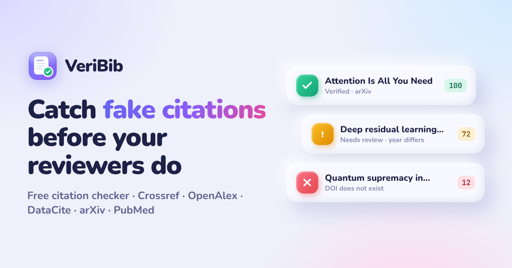

# VeriBib

**Free citation checker that catches AI-hallucinated references.**
Paste a bibliography and VeriBib verifies every entry against Crossref, OpenAlex, DataCite, arXiv, PubMed, Google Books and live web pages. It then flags what's fake and gives you corrected citations.

**[Try it →](https://takmashhido.github.io/VeriBib/)**

[](https://github.com/TakMashhido/VeriBib/actions/workflows/ci.yml)
[](LICENSE)



## What it catches

- **Fabricated DOIs**: identifiers that no DOI agency has registered
- **Borrowed identifiers**: a real DOI or arXiv ID attached to the wrong paper
- **Misattribution**: a real title credited to different authors or the wrong year
- **Dead or mismatched links**: for blog posts, docs and other web citations

Every verdict shows its evidence (title, author, year and identifier checks), and verified entries can be copied or exported as **APA, IEEE, MLA or BibTeX**.

**Input formats:** APA, MLA, Chicago, Harvard, IEEE, Vancouver, BibTeX, RIS, and bare DOIs, arXiv IDs, PMIDs, ISBNs or URLs. Mixed lists work too.

## Run it yourself

Requires Node.js 20+. There are no dependencies to install.

```bash
git clone https://github.com/TakMashhido/VeriBib.git
```

```bash
cd VeriBib && npm start
```

Then open http://localhost:3847.

| Variable | Purpose |
| --- | --- |
| `PORT` | Port to listen on (default `3847`) |
| `CONTACT_EMAIL` | Sent to Crossref, OpenAlex and NCBI to join their faster "polite" pools. Recommended. |
| `OPENALEX_API_KEY` | Optional OpenAlex key for higher search limits |

### Static hosting

`public/` is a complete static site; the GitHub Pages workflow deploys it from `main`. Without the server, checks run in the visitor's browser using the same engine. The only difference is that browsers can't read other sites, so cited web pages are pinged rather than inspected.

## API

```bash
curl -X POST http://localhost:3847/api/verify \
  -H 'Content-Type: application/json' \
  -d '{"text": "Vaswani, A., et al. (2017). Attention is all you need. NeurIPS."}'
```

Returns `{ bibliography, summary, results[] }`. Each result has a `verification` object containing `status` (`verified` | `needs_review` | `not_found`), `confidence`, `message`, `checks`, `flags`, `matchedRecord` and `citations`. Add `?stream=1` to receive NDJSON events as each reference finishes. Up to 150 references per request.

## Development

```bash
npm test
```

```
server.js          HTTP server + API
public/            static site (index.html, app.js, styles.css)
public/lib/        verification engine, shared by server and browser
  parse.js         splitting and field extraction
  providers.js     registry clients, rate limiting, link inspection
  verify.js        scoring and verdicts
  format.js        APA / IEEE / MLA / BibTeX output
test/              node:test suites (offline)
```

## License

MIT © [Koustav Kumar Mondal](https://koustav.isroot.in)
